# Smart Retail - System Architecture

## 1

–––

. Architecture Overview

Smart Retail follows a Microservices Architecture.

The frontend communicates with backend services through an API Gateway.

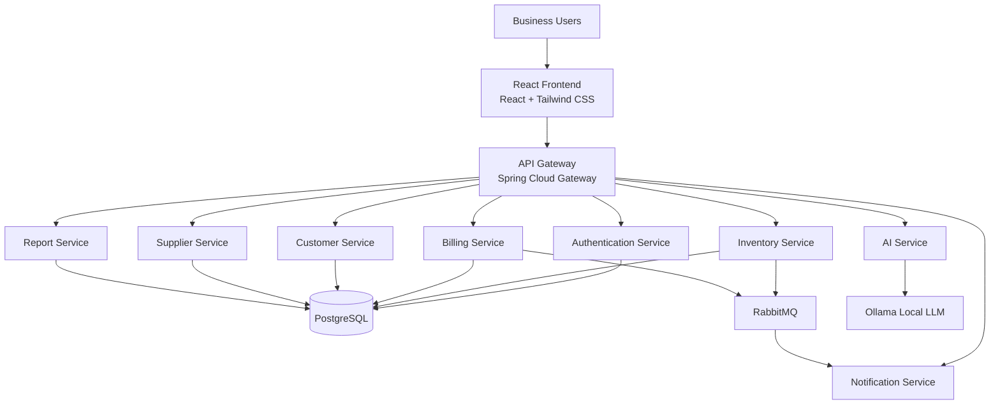

---

# 2. Architecture Principles

The system follows:

- Separation of Concerns
- Single Responsibility
- Loose Coupling
- High Cohesion
- Independent Service Deployment
- Stateless REST APIs
- Secure Communication
- Database Isolation
- Horizontal Scalability
- Asynchronous Processing
- Multi-Tenant Data Isolation

---

# 3. Frontend Architecture

The frontend is built with:

- React.js
- Tailwind CSS
- Axios
- React Router

Responsibilities:

- UI
- Navigation
- Authentication State
- Dashboard
- Forms
- Tables
- Charts
- API Communication
- AI Chat
- Client-Side Routing

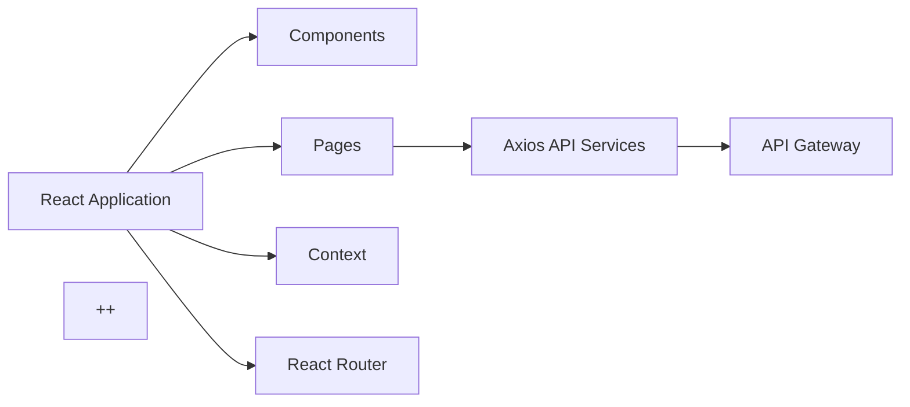

---

# 4. Frontend Navigation

The main dashboard navigation contains:

```text
Dashboard
Inventory
Billing
Customers
Suppliers
Reports
AI Assistant
Profile
```

Example:

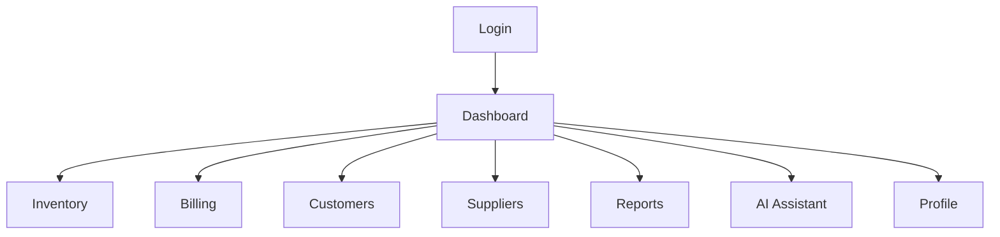

---

# 5. API Gateway

Spring Cloud Gateway is the single entry point for backend APIs.

Responsibilities:

- Request Routing
- JWT Validation
- CORS
- Request Filtering
- Rate Limiting
- Service Routing
- Centralized Security

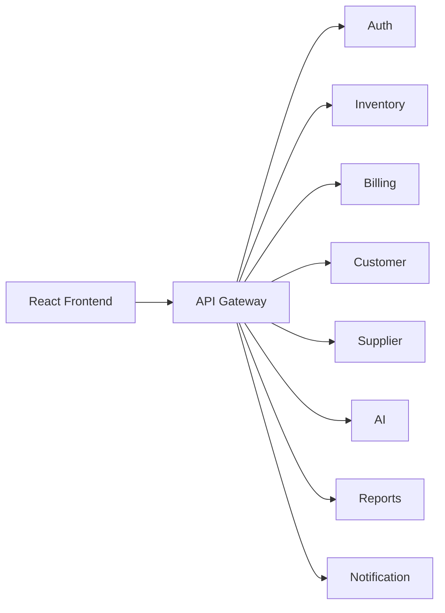

---

# 6. Authentication Service

Responsibilities:

- Registration
- Login
- Logout
- Password Hashing
- JWT Generation
- JWT Validation
- User Management
- Role Management
- Authorization
- Business Registration

Main entities:

```text
Business
User
Role
```

Authentication flow:

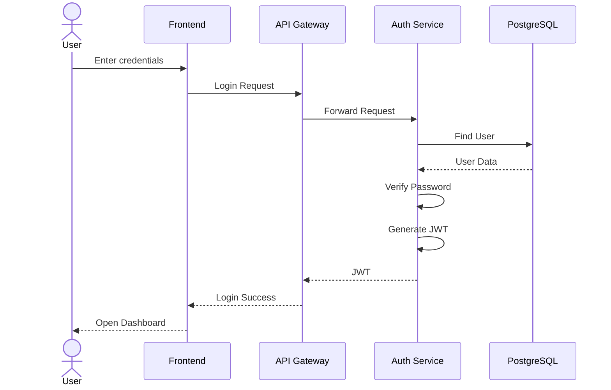

---

# 7. Inventory Service

The Inventory Service manages:

- Products
- Categories
- Barcode
- Stock
- Batch
- Manufacturing Date
- Expiry Date
- Stock In
- Stock Out
- Stock History
- Low Stock
- Expiry Detection

Main entities:

```text
Product
Category
Batch
Inventory
StockHistory
```

---

# 8. Billing Service

Responsibilities:

- Invoice
- Invoice Items
- GST
- Discount
- Payment
- Invoice History
- Stock Deduction

Billing communicates with Inventory Service.

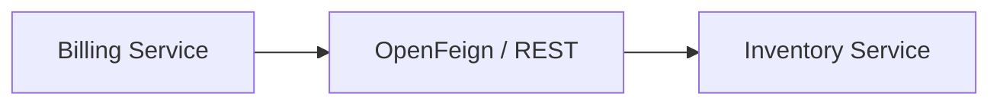

---

# 9. Customer Service

Responsibilities:

- Customer CRUD
- Customer Search
- Customer Information
- Purchase History
- Invoice History

Entity:

```text
Customer
```

---

# 10. Supplier Service

Responsibilities:

- Supplier CRUD
- Supplier Information
- Purchase Orders
- Purchase Order History
- Supplier Performance

Entities:

```text
Supplier
PurchaseOrder
PurchaseOrderItem
```

---

# 11. Report Service

Responsibilities:

- Daily Sales
- Monthly Sales
- Revenue
- Product Sales
- Inventory Report
- Customer Report
- Supplier Report
- Purchase Report
- Low Stock Report
- Expiry Report
- Dashboard Statistics
- PDF Export
- Excel Export

---

# 12. Notification Service

Notification Service handles asynchronous notifications.

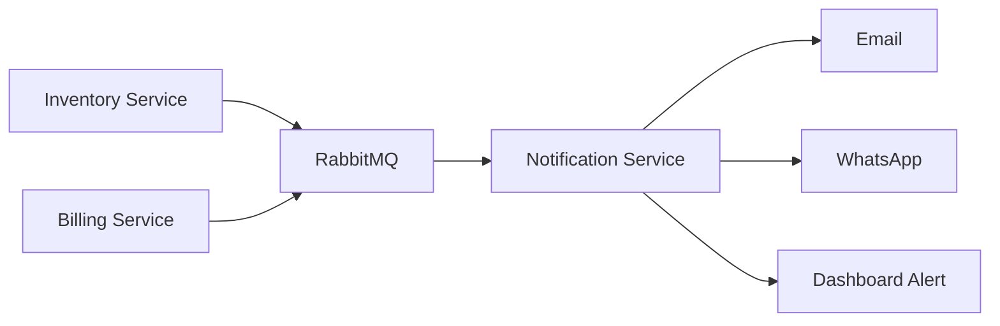

---

# 13. AI Service

The AI Service is responsible for Business Intelligence.

The AI service uses read-only, fixed SQL tools for tenant-scoped inventory and invoice data. It never accepts SQL from a user. The service combines those live tools with the retrieval and forecast components below.

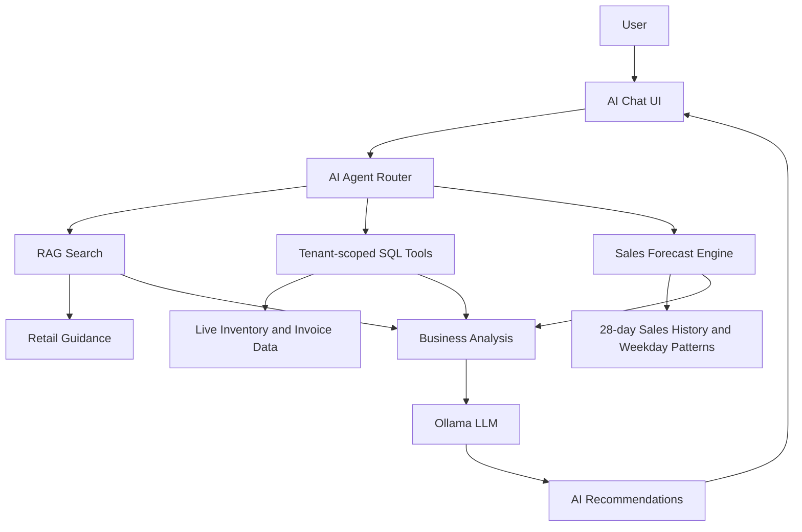

---

# 14. AI Business Intelligence

The AI Agent currently handles:

```text
Which products are low in stock?

What were my sales today?

What are the current stock, expiry, or below-cost risks?

What were recent invoice sales and gross profit?

What is the estimated sales total for the next seven days?

Which products may expire soon?

What should I stock before Diwali?
```

The AI Agent follows:

```text
User Question
      |
      v
Agent Router
      |
      v
RAG Search + Read-only SQL Tools + Forecast Engine
      |
      v
Build Tenant-scoped Business Context
      |
      v
Ollama LLM (with a live-data fallback)
      |
      v
Business Answer
```

---

# 15. AI Service Safety and Control

The AI Service controls what information is sent to Ollama.

The service should:

1. Authenticate the user.
2. Identify the user's business.
3. Validate the requested operation.
4. Retrieve only required business data.
5. Remove unnecessary sensitive information.
6. Build structured business context.
7. Send the minimum relevant context to Ollama.
8. Return the generated response.

The AI should not receive unrestricted database access.

---

# 16. Service-to-Service Communication

## REST

Used for synchronous communication.

```text
Billing
   |
   | REST
   v
Inventory
```

## OpenFeign

Used to simplify REST communication between Spring Boot services.

```text
Billing
   |
   v
InventoryClient
   |
   v
Inventory Service
```

## RabbitMQ

Used for asynchronous events.

```text
Inventory
   |
   v
RabbitMQ
   |
   v
Notification
```

---

# 17. Database Architecture

For the college project, PostgreSQL can initially be used as one database with logical separation.

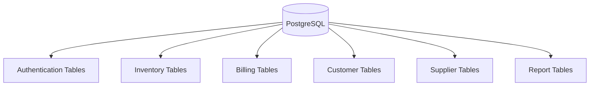

---

# 18. Production Database Architecture

For production, each service can own its database.

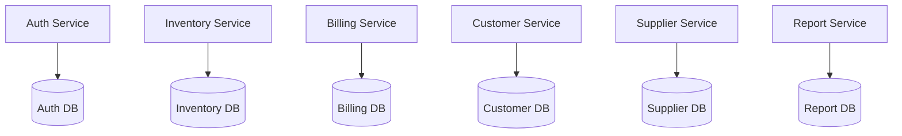

This provides stronger service independence.

---

# 19. Multi-Tenant Architecture

The platform supports multiple businesses.

Every business-related record should contain:

```text
business_id
```

Example:

```text
Business A
business_id = 1

Business B
business_id = 2
```

Data flow:

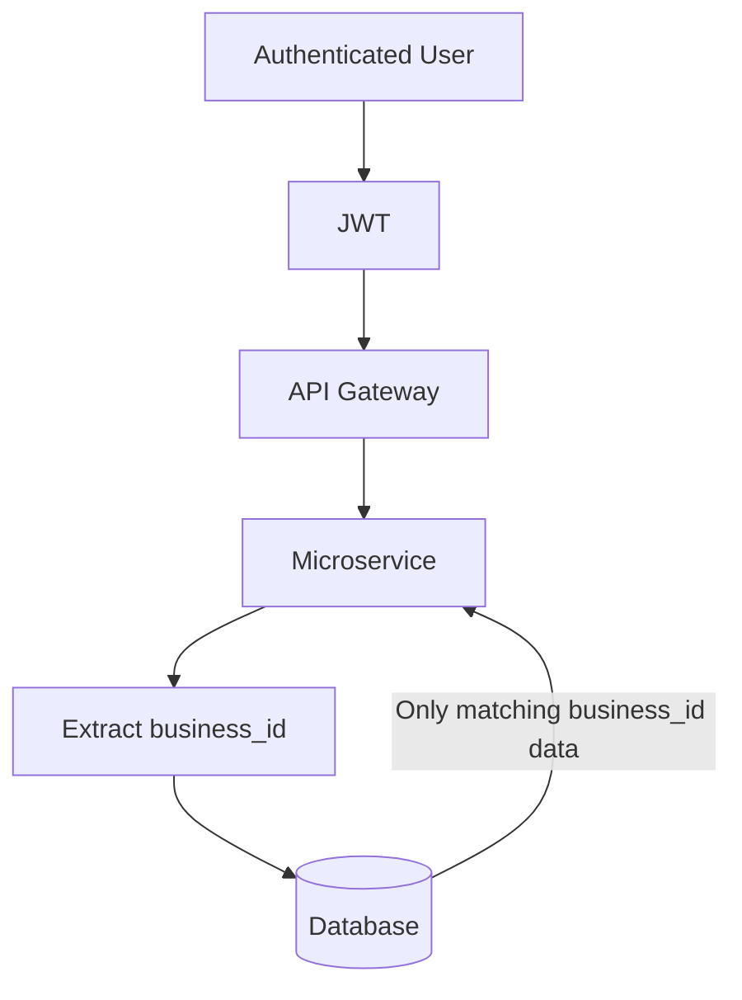

---

# 20. Concurrency Architecture

The application must support multiple users simultaneously.

Example:

```text
User A ----+
           |
User B ----+----> API Gateway
           |
User C ----+
```

For stock updates:

```text
Initial Stock = 10

User A wants 7
User B wants 5
```

Only one transaction should update the stock when required.

Recommended:

- Transactions
- Atomic Updates
- Optimistic Locking
- Pessimistic Locking where required
- Transaction Isolation
- Database Constraints

Example:

```sql
UPDATE inventory
SET available_quantity = available_quantity - :quantity
WHERE product_id = :productId
AND available_quantity >= :quantity;
```

The application should check whether the update was successful.

---

# 21. Billing Transaction Architecture

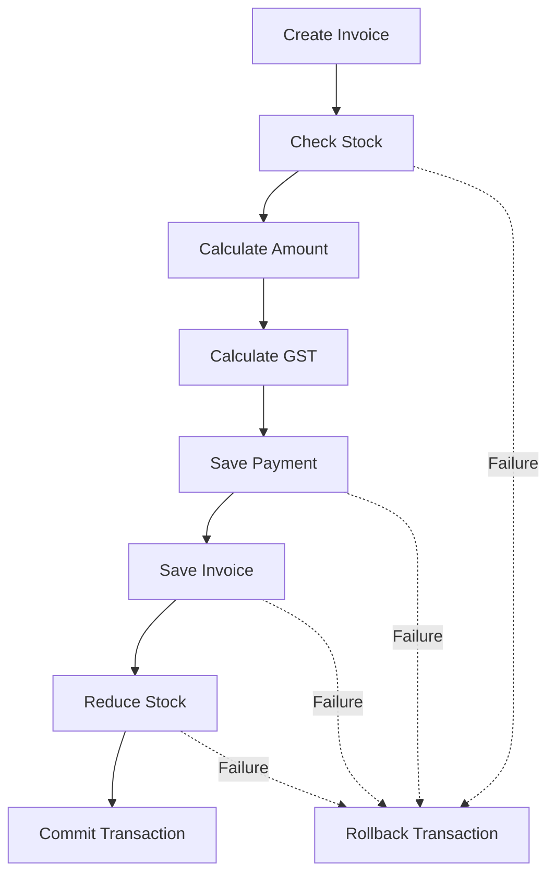

---

# 22. Scalability

Services can be horizontally scaled.

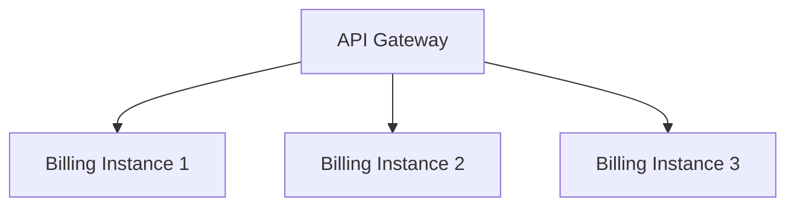

The same pattern can be applied to:

- Inventory
- AI
- Reports
- Notifications

---

# 23. Caching

Redis can be added in the future.

Potential cached information:

- Products
- Categories
- Dashboard Statistics
- Frequently Requested Reports
- Permissions

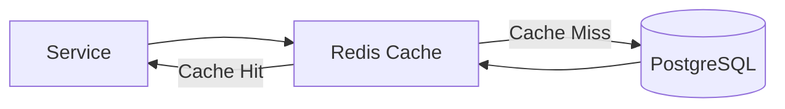

---

# 24. Security Architecture

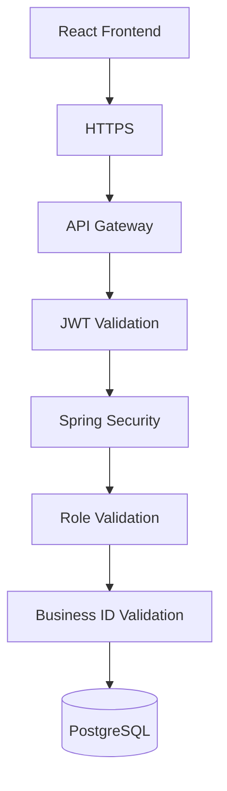

---

# 25. Deployment Architecture

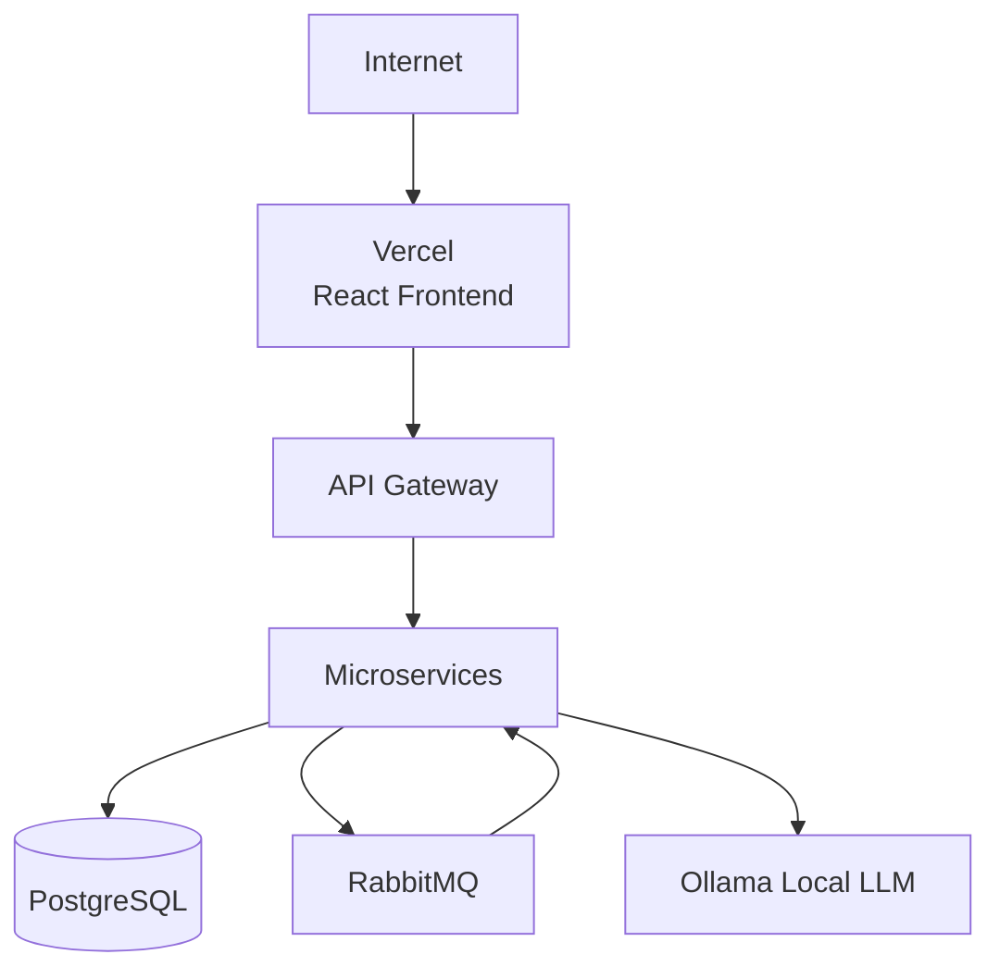

---

# 26. Production Architecture

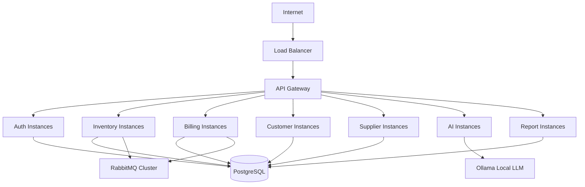

---

# 27. Observability

Future production deployment should include:

- Spring Boot Actuator
- Centralized Logging
- Metrics
- Health Checks
- Error Monitoring
- Distributed Tracing
- Prometheus
- Grafana
- OpenTelemetry

---

# 28. Recommended Development Order

```text
Phase 1
Authentication
JWT
Roles
Dashboard

        ↓

Phase 2
Products
Categories
Inventory
Stock
Batch
Expiry

        ↓

Phase 3
Billing
Invoice
GST
Payment
Stock Deduction

        ↓

Phase 4
Customers
Suppliers
Purchase Orders

        ↓

Phase 5
Reports
PDF
Excel
Dashboard Analytics

        ↓

Phase 6
AI Service
Ollama
AI Chatbot
Business Intelligence

        ↓

Phase 7
RabbitMQ
Notifications
Alerts

        ↓

Phase 8
Docker
Caching
Concurrency
Monitoring
Scalability
```

---

# 29. Architecture Summary

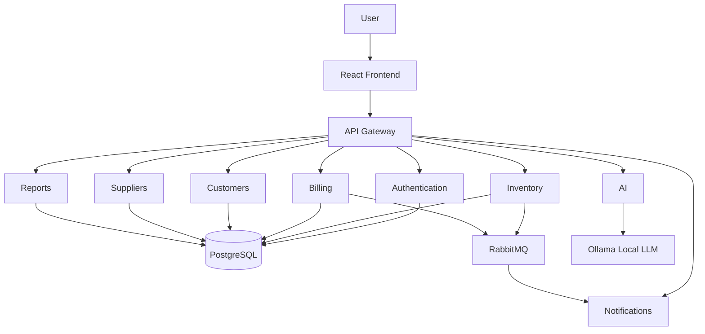
