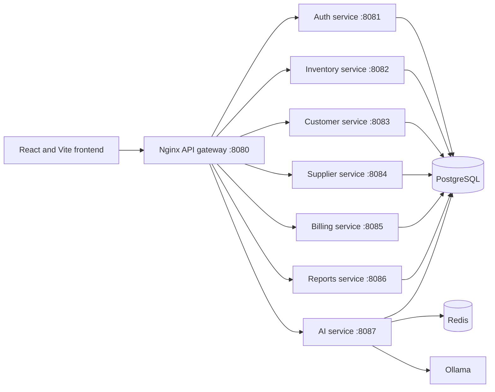

# Smart Retail

Smart Retail is a multi-tenant retail management and business intelligence application. It brings point-of-sale billing, inventory, customer and supplier records, reports, and AI-assisted business insights into one workspace.

## Contents

- [Highlights](#highlights)
- [Architecture](#architecture)
- [Technology](#technology)
- [Requirements](#requirements)
- [Run with Docker Compose](#run-with-docker-compose)
- [Run the frontend locally](#run-the-frontend-locally)
- [Configuration](#configuration)
- [Reports and API](#reports-and-api)
- [AI assistant](#ai-assistant)
- [Billing email and payment reminders](#billing-email-and-payment-reminders)
- [Tests](#tests)
- [Known limitations](#known-limitations)
- [Project layout](#project-layout)

## Highlights

- Dashboard with sales and profit summaries, trend charts, product performance, inventory health, customer insights, cash and payment summaries, alerts, and business health indicators.
- Point-of-sale billing with saved customers, product and stock validation, discounts, GST calculations, split payment tender details, and invoice history.
- Invoice PDF generation and email delivery with a printable bill attached.
- Inventory, customers, suppliers, sales reports, CSV exports, and a Cash & Payments register.
- Collapsible navigation and responsive dashboard layouts.
- AI business assistant for supported questions about sales, customers, inventory, and business performance.
- JWT-protected APIs and business-scoped data access.

## Architecture

The React application sends API requests through the Nginx gateway. The gateway routes requests to Spring Boot services. PostgreSQL stores application data; Redis supports the AI service; Ollama provides local language models for AI responses.



| Component | Port | Responsibility |
|---|---:|---|
| Nginx API gateway | 8080 | Routes `/api` requests to backend services |
| Auth service | 8081 | Authentication and business/user access |
| Inventory service | 8082 | Products and inventory operations |
| Customer service | 8083 | Customer records |
| Supplier service | 8084 | Supplier records |
| Billing service | 8085 | Bills, invoices, payment summaries, and invoice emails |
| Reports service | 8086 | Read-only sales, inventory, tax, and customer reports |
| AI service | 8087 | AI chat and business analysis |
| PostgreSQL | 55432 on host | Persistent application database |
| Redis | 56300 on host | AI service support/cache |

## Technology

- **Frontend:** React 18, Vite, React Router, Axios, CSS
- **Backend:** Java 21, Spring Boot, Spring Security, Spring Data JPA, Maven
- **Database:** PostgreSQL 16
- **Gateway:** Nginx
- **AI:** Ollama with Qwen models; Redis
- **Local development and services:** Docker Compose

## Requirements

- Docker Desktop with Docker Compose
- Node.js and npm for local frontend development
- Git
- Internet access the first time Docker images, npm packages, or Ollama models are downloaded

## Run with Docker Compose

1. Create a root `.env` file alongside `docker-compose.yml`. Use the variables in [Configuration](#configuration), and replace every example value with your own. Do not commit credentials.
2. Start the database, backend services, gateway, Redis, and Ollama:

   ```bash
   docker compose up -d --build
   ```

3. Download the default AI models into the persistent Ollama volume:

   ```bash
   docker compose exec ollama ollama pull qwen2.5:1.5b
   docker compose exec ollama ollama pull qwen3:4b
   ```

4. Start the frontend using the steps below. Open `http://localhost:5173`.

The API gateway is available at `http://localhost:8080`. PostgreSQL is published on host port `55432`; Redis is published on `56300`. Compose uses the internal service names and ports for service-to-service calls.

To stop the stack while preserving database and Ollama data:

```bash
docker compose down
```

To remove persistent database, Redis, and Ollama data as well, use `docker compose down -v`. This permanently deletes local volume data.

## Run the frontend locally

The frontend package is in `frontend/public`:

```bash
cd frontend/public
npm install
npm run dev
```

Vite serves the app at `http://localhost:5173` and proxies `/api` requests to the gateway at `http://localhost:8080`. If your gateway runs elsewhere, set `VITE_API_PROXY_TARGET` before starting Vite. To build the static frontend bundle:

```bash
npm run build
```

## Configuration

The backend services read environment values from the root `.env` file when running in Docker Compose. Create the file locally; never paste real credentials into this README or commit them.

```env
POSTGRES_DB=smart_retail
POSTGRES_USER=postgres
POSTGRES_PASSWORD=replace_with_a_database_password
JWT_SECRET=replace_with_a_long_random_secret

# SMTP is used for authentication emails and billing invoice emails.
MAIL_HOST=smtp.gmail.com
MAIL_PORT=587
MAIL_USERNAME=your_sending_email
MAIL_PASSWORD=your_smtp_or_app_password

# Optional AI model overrides. Pull selected tags into the Ollama container first.
OLLAMA_FAST_MODEL=qwen2.5:1.5b
OLLAMA_REASONING_MODEL=qwen3:4b
OLLAMA_TIMEOUT_SECONDS=180
```

Compose defaults `DB_HOST` to `postgres` and `DB_PORT` to `5432` for containers. Gmail accounts commonly require an app password when two-step verification is enabled. Use your SMTP provider's supported credentials and security requirements.

## Reports and API

Protected API routes are exposed through the gateway at `http://localhost:8080`. The frontend attaches the signed-in session's bearer token to protected requests.

The reports service is tenant-scoped and exposes these authenticated endpoints:

| Endpoint | Purpose |
|---|---|
| `GET /api/reports/overview?from=YYYY-MM-DD&to=YYYY-MM-DD` | Summary metrics for a date range |
| `GET /api/reports/sales?from=YYYY-MM-DD&to=YYYY-MM-DD` | Sales totals and daily trend |
| `GET /api/reports/inventory` | Current inventory measures |
| `GET /api/reports/tax?from=YYYY-MM-DD&to=YYYY-MM-DD` | GST totals and tax breakdown |
| `GET /api/reports/customers?from=YYYY-MM-DD&to=YYYY-MM-DD` | Customer sales summary |
| `GET /api/reports/invoices?from=YYYY-MM-DD&to=YYYY-MM-DD&page=0&size=50&search=` | Paginated invoice register (maximum page size 100) |
| `GET /api/reports/invoices?all=true&page=0&size=50&search=` | Paginated invoice register across all dates |
| `GET /api/reports/invoices/{invoiceId}/items?from=YYYY-MM-DD&to=YYYY-MM-DD` | Product lines for an invoice |
| `GET /api/reports/products/combinations?from=YYYY-MM-DD&to=YYYY-MM-DD` | Frequently co-purchased product pairs |

Billing and reports use the `Asia/Kolkata` business timezone. Existing legacy invoice timestamps are preserved because their database field does not include timezone metadata.

## AI assistant

The AI assistant can answer supported questions about current business data, provide retail guidance, and estimate sales trends. It routes questions to fixed, business-scoped data queries; it does not execute SQL supplied by users. Forecasts are estimates and should be treated as guidance.

The default Ollama tags are `qwen2.5:1.5b` for fast requests and `qwen3:4b` for reasoning requests. Pull both models as shown in [Run with Docker Compose](#run-with-docker-compose). The authenticated chat endpoint is:

```http
POST /api/ai/chat
Content-Type: application/json

{"message":"What needs attention today?"}
```

The AI service also supports streamed chat through its `/api/ai/chat/stream` route.

## Billing email and payment reminders

When an invoice is emailed, the customer receives a formatted email with the generated invoice PDF attached. The PDF contains the bill details, business and customer information available to the system, GST details when applicable, item quantities and prices, discounts, totals, and recorded payment information.

The billing service checks overdue balance invoices every 60 seconds by default. A reminder is eligible when the invoice is still marked unpaid, has a due date, has not already received a reminder, and belongs to a saved customer with an email address. The reminder email includes the invoice total, recorded amount paid, current recorded balance, due date, and the generated invoice PDF. The scheduler currently sends at most one reminder per invoice.

Configure `MAIL_HOST`, `MAIL_PORT`, `MAIL_USERNAME`, and `MAIL_PASSWORD` to enable email delivery. When SMTP is unavailable, a bill can still be created; the response reports that email delivery failed.

**Payment collection limitation:** Cash & Payments currently displays payment and outstanding-balance information, but the application does not provide a workflow to record a later collection against an existing balance invoice. Reminder emails and attached PDFs therefore reflect the payment values currently saved on the invoice.

## Tests

Run frontend tests from `frontend/public`:

```bash
npm test
```

Backend services are Maven projects. Run a service's test suite from its directory, for example:

```bash
cd billing-service
mvn test
```

## Known limitations

- Later payments against an existing balance invoice cannot currently be recorded in the UI or through a dedicated payment-collection endpoint.
- Payment reminders are sent once per invoice; recurring reminder intervals are not configurable yet.
- Supplier performance and purchase history depend on purchase-order data. Where the schema does not store those records, corresponding purchase analytics are unavailable.
- AI responses and forecasts depend on Ollama availability and are decision support, not guaranteed predictions.

## Project layout

```text
.
├── ai-service/          # AI chat, business analysis, and Ollama integration
├── auth-service/        # Authentication and business access
├── billing-service/     # Billing, invoices, payment reporting, email/PDF
├── customer-service/    # Customer management
├── frontend/public/     # React and Vite application
├── gateway/             # Nginx gateway configuration
├── inventory-service/   # Products and stock
├── reports-service/     # Business reports and exports
├── supplier-service/    # Supplier management
├── docker-compose.yml
├── ARCHITECTURE.md
└── UML-DIAGRAMS.md
```

## Security notes

- Use a unique, high-entropy `JWT_SECRET` and strong database credentials.
- Store credentials in local environment configuration or a secrets manager; never commit `.env` files.
- Use HTTPS and production-grade secret storage when deploying outside a local development environment.
- Keep access tokens and business data private. The backend should remain the authority for tenant access checks.
