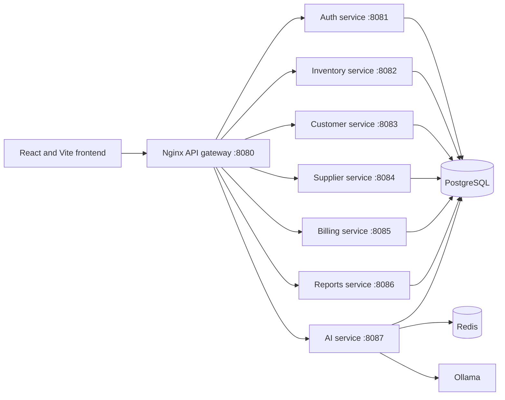

# RetailMind

RetailMind is a multi-tenant retail management and business intelligence application. It brings point-of-sale billing, inventory, customer and supplier records, reports, and an AI business assistant into one workspace. The backend is a set of Spring Boot microservices behind an Nginx gateway, with a React frontend.

## Highlights

- **Dashboard** with sales and profit summaries, trend charts, product performance, inventory health, customer insights, cash and payment summaries, alerts, and business health indicators.
- **Point-of-sale billing** with saved customers, product and stock validation, discounts, GST calculations, split payment tender details, and invoice history.
- **Invoice PDFs and email**: a printable receipt is generated and emailed to the customer.
- **Inventory, customers and suppliers**, plus sales reports, CSV exports, and a Cash & Payments register.
- **AI business assistant** for questions about sales, customers, inventory, and business performance, running on local models through Ollama.
- **Secure by design**: JWT-protected APIs, email OTP signup, and business-scoped (multi-tenant) data access.
- Responsive layout with collapsible navigation.

## Screenshots

<!-- Add screenshots to docs/screenshots/ and uncomment:


-->

## Architecture

The React application sends API requests through the Nginx gateway. The gateway routes requests to Spring Boot services. PostgreSQL stores application data; Redis supports the auth and AI services; Ollama provides local language models for AI responses.



| Component         |          Port | Responsibility                                         |
| ----------------- | ------------: | ------------------------------------------------------ |
| Nginx API gateway |          8080 | Routes `/api` requests to backend services             |
| Auth service      |          8081 | Authentication and business/user access                |
| Inventory service |          8082 | Products and inventory operations                      |
| Customer service  |          8083 | Customer records                                       |
| Supplier service  |          8084 | Supplier records                                       |
| Billing service   |          8085 | Bills, invoices, payment summaries, and invoice emails |
| Reports service   |          8086 | Read-only sales, inventory, tax, and customer reports  |
| AI service        |          8087 | AI chat and business analysis                          |
| PostgreSQL        | 55432 on host | Persistent application database                        |
| Redis             | 56300 on host | Cache and AI service support                           |

More detail is in [ARCHITECTURE.md](ARCHITECTURE.md) and [UML-DIAGRAMS.md](UML-DIAGRAMS.md).

## Technology

| Layer          | Stack                                                           |
| -------------- | --------------------------------------------------------------- |
| Frontend       | React 18, Vite, React Router, Axios, CSS                        |
| Backend        | Java 21, Spring Boot 3, Spring Security, Spring Data JPA, Maven |
| Database       | PostgreSQL 16                                                   |
| Cache          | Redis 7                                                         |
| Gateway        | Nginx                                                           |
| AI             | Ollama with Qwen models                                         |
| Infrastructure | Docker Compose                                                  |

## Requirements

- Docker Desktop with Docker Compose
- JDK 21 and Maven (to build the service jars)
- Node.js and npm (for the frontend)
- Git
- Internet access the first time Docker images, Maven and npm packages, or Ollama models are downloaded

## Quick start

### 1. Clone the repository

```bash
git clone https://github.com/Bhakti-909/retailmind-Billing-and-inventory-system.git
cd retailmind-Billing-and-inventory-system
```

### 2. Create the `.env` file

Create a `.env` file next to `docker-compose.yml`, using the variables in [Configuration](#configuration). Replace every example value with your own. Never commit this file.

### 3. Build the service jars

Each service's Dockerfile copies a prebuilt jar from its `target/` folder, so the jars must be built before Docker builds the images.

macOS / Linux / Git Bash:

```bash
for service in auth-service inventory-service customer-service supplier-service billing-service reports-service ai-service; do
  (cd $service && mvn clean package -DskipTests)
done
```

Windows Command Prompt:

```bat
for %d in (auth-service inventory-service customer-service supplier-service billing-service reports-service ai-service) do (pushd %d & mvn clean package -DskipTests & popd)
```

### 4. Start the backend

Make sure Docker Desktop is running, then:

```bash
docker compose up -d --build
```

Download the default AI models into the persistent Ollama volume (optional, only needed for the AI assistant):

```bash
docker compose exec ollama ollama pull qwen2.5:1.5b
docker compose exec ollama ollama pull qwen3:4b
```

### 5. Start the frontend

```bash
cd frontend/public
npm install
npm run dev
```

Open `http://localhost:5173`. Vite proxies `/api` requests to the gateway at `http://localhost:8080`. If your gateway runs elsewhere, set `VITE_API_PROXY_TARGET` before starting Vite. To build the static bundle, run `npm run build`.

### Stopping

```bash
docker compose down
```

This keeps database and Ollama data. To delete all persistent data as well, use `docker compose down -v`.

## Configuration

The backend services read environment values from the root `.env` file when running in Docker Compose.

```env
POSTGRES_DB=smart_retail
POSTGRES_USER=postgres
POSTGRES_PASSWORD=replace_with_a_database_password
JWT_SECRET=replace_with_a_long_random_secret

# SMTP is used for signup OTP emails and billing invoice emails.
MAIL_HOST=smtp.gmail.com
MAIL_PORT=587
MAIL_USERNAME=your_sending_email
MAIL_PASSWORD=your_smtp_or_app_password

# Optional AI model overrides. Pull selected tags into the Ollama container first.
OLLAMA_FAST_MODEL=qwen2.5:1.5b
OLLAMA_REASONING_MODEL=qwen3:4b
OLLAMA_TIMEOUT_SECONDS=180
```

Compose defaults `DB_HOST` to `postgres` and `DB_PORT` to `5432` for containers. Gmail accounts need an **app password** (Google Account > Security > 2-Step Verification > App passwords), not your normal password. Use your SMTP provider's supported credentials and security requirements.

## Reports and API

Protected API routes are exposed through the gateway at `http://localhost:8080`. The frontend attaches the signed-in session's bearer token to protected requests.

The reports service is tenant-scoped and exposes these authenticated endpoints:

| Endpoint                                                                         | Purpose                                            |
| -------------------------------------------------------------------------------- | -------------------------------------------------- |
| `GET /api/reports/overview?from=YYYY-MM-DD&to=YYYY-MM-DD`                        | Summary metrics for a date range                   |
| `GET /api/reports/sales?from=YYYY-MM-DD&to=YYYY-MM-DD`                           | Sales totals and daily trend                       |
| `GET /api/reports/inventory`                                                     | Current inventory measures                         |
| `GET /api/reports/tax?from=YYYY-MM-DD&to=YYYY-MM-DD`                             | GST totals and tax breakdown                       |
| `GET /api/reports/customers?from=YYYY-MM-DD&to=YYYY-MM-DD`                       | Customer sales summary                             |
| `GET /api/reports/invoices?from=YYYY-MM-DD&to=YYYY-MM-DD&page=0&size=50&search=` | Paginated invoice register (maximum page size 100) |
| `GET /api/reports/invoices?all=true&page=0&size=50&search=`                      | Paginated invoice register across all dates        |
| `GET /api/reports/invoices/{invoiceId}/items?from=YYYY-MM-DD&to=YYYY-MM-DD`      | Product lines for an invoice                       |
| `GET /api/reports/products/combinations?from=YYYY-MM-DD&to=YYYY-MM-DD`           | Frequently co-purchased product pairs              |

Billing and reports use the `Asia/Kolkata` business timezone. Existing legacy invoice timestamps are preserved because their database field does not include timezone metadata.

## AI assistant

The AI assistant can answer supported questions about current business data, provide retail guidance, and estimate sales trends. It routes questions to fixed, business-scoped data queries and does not execute SQL supplied by users. Forecasts are estimates and should be treated as guidance.

The default Ollama tags are `qwen2.5:1.5b` for fast requests and `qwen3:4b` for reasoning requests. The authenticated chat endpoint is:

```http
POST /api/ai/chat
Content-Type: application/json

{"message":"What needs attention today?"}
```

Streamed chat is available at `/api/ai/chat/stream`.

## Billing email and payment reminders

When an invoice is emailed, the customer receives a formatted email with the generated invoice PDF attached. The PDF contains the bill details, business and customer information, GST details when applicable, item quantities and prices, discounts, totals, and recorded payment information.

The billing service checks overdue balance invoices every 60 seconds by default. A reminder is eligible when the invoice is still marked unpaid, has a due date, has not already received a reminder, and belongs to a saved customer with an email address. The scheduler sends at most one reminder per invoice.

Configure `MAIL_HOST`, `MAIL_PORT`, `MAIL_USERNAME`, and `MAIL_PASSWORD` to enable email delivery. When SMTP is unavailable, a bill can still be created and the response reports that email delivery failed.

## Tests

Frontend tests, from `frontend/public`:

```bash
npm test
```

Backend services are Maven projects. Run a service's tests from its directory, for example:

```bash
cd billing-service
mvn test
```

## Troubleshooting

**`COPY target/...jar: no such file or directory` during `docker compose up`**
The service jars have not been built. Run the build step in [Quick start](#quick-start) first.

**`failed to connect to the docker API` / `dockerDesktopLinuxEngine` not found**
Docker Desktop is not running. Open it and wait for "Engine running", then retry.

**`no configuration file provided: not found`**
Run Docker Compose commands from the folder that contains `docker-compose.yml`.

**Registration fails with `null value in column "id" of relation "businesses"`**
On a fresh database the `businesses` table can be created without an auto-generated id. Workaround:

```bash
docker compose exec postgres psql -U postgres -d smart_retail -c "ALTER TABLE businesses ALTER COLUMN id ADD GENERATED BY DEFAULT AS IDENTITY;"
```

**OTP email never arrives**
Check `docker compose logs --tail 30 auth-service`. An authentication error means `MAIL_USERNAME` or `MAIL_PASSWORD` in `.env` is wrong. After fixing it, run `docker compose up -d auth-service billing-service`.

**Maven fails on PDF code with `unreported exception java.io.IOException`**
Make sure you are on the latest commit. The PDF helper methods in `InvoicePdfService` declare `throws IOException`.

## Known limitations

- Later payments against an existing balance invoice cannot currently be recorded in the UI or through a dedicated payment-collection endpoint. Cash & Payments shows payment and outstanding-balance information only, so reminder emails and PDFs reflect the values saved on the invoice.
- Payment reminders are sent once per invoice; recurring reminder intervals are not configurable yet.
- Supplier performance and purchase history depend on purchase-order data. Where the schema does not store those records, the corresponding purchase analytics are unavailable.
- AI responses and forecasts depend on Ollama availability and are decision support, not guaranteed predictions.

## Project layout

```text
.
├── ai-service/          # AI chat, business analysis, and Ollama integration
├── auth-service/        # Authentication and business access
├── billing-service/     # Billing, invoices, payment reporting, email/PDF
├── customer-service/    # Customer management
├── frontend/public/     # React and Vite application
├── gateway/             # Nginx gateway configuration
├── inventory-service/   # Products and stock
├── reports-service/     # Business reports and exports
├── supplier-service/    # Supplier management
├── docker-compose.yml
├── ARCHITECTURE.md
└── UML-DIAGRAMS.md
```

## Security notes

- Use a unique, high-entropy `JWT_SECRET` and strong database credentials.
- Store credentials in local environment configuration or a secrets manager; never commit `.env` files.
- Use HTTPS and production-grade secret storage when deploying outside a local development environment.
- Keep access tokens and business data private. The backend remains the authority for tenant access checks.
